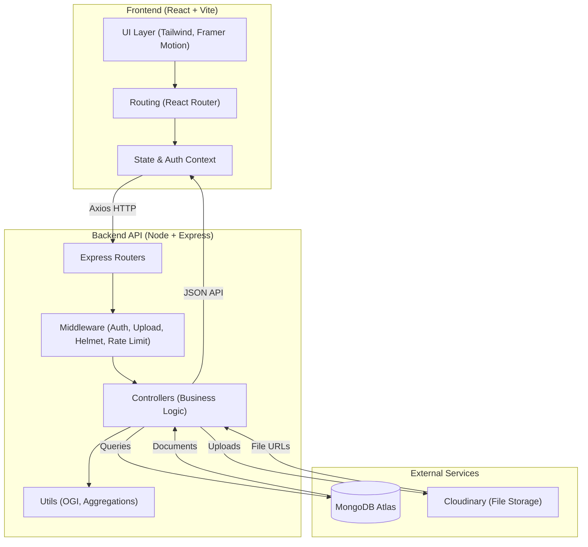
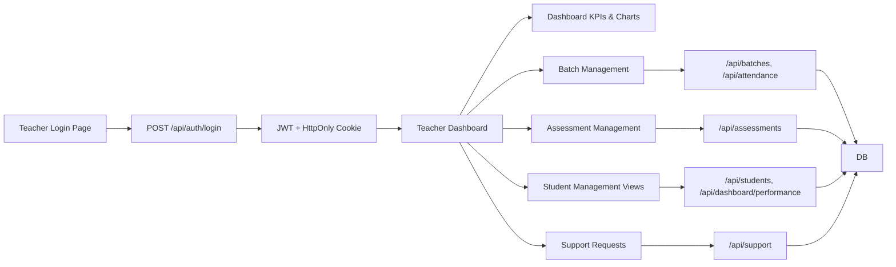

# Mind Rise System Architecture

This document illustrates the high-level architecture and core data flows of the **Mind Rise** platform.

## 1. High-Level System Diagram

## 2. Teacher Module Flow (Mind Rise)

## 3. Key Components

1. **Frontend**
   - React 19 + Vite
   - Tailwind CSS + Framer Motion + Recharts
   - Role-aware routing for Admin, Teacher, and Student dashboards

2. **Backend**
   - Express 5 server with modular routers (`auth`, `students`, `batches`, `attendance`, `assessments`, `support`, `dashboard`, `teachers`, `contact`)
   - JWT-based authentication and role-based authorization middleware
   - Helmet + rate limiting for baseline security

3. **Database**
   - MongoDB Atlas storing Users, Students, Teachers, Batches, Attendance, Assessments, Submissions, SupportRequests, etc.

4. **Storage**
   - Cloudinary used for assignment uploads, support attachments, and batch images, integrated via Multer + CloudinaryStorage with a 10MB upload limit.

5. **Analytics**
   - Overall Growth Index (OGI), attendance summaries, quiz/assignment analytics, and teacher KPIs computed in backend utilities and exposed via `/api/dashboard/*` and student/teacher detail endpoints.
