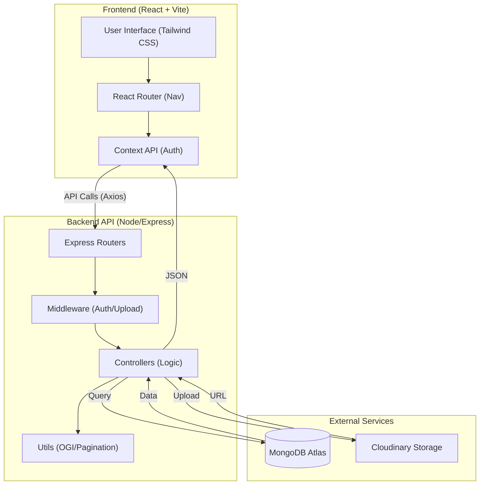

# NavKalpana System Architecture

This diagram illustrates the high-level architecture and data flow of the **NavKalpana** platform.

### Key Components:

1.  **Frontend**: Built with React 19 and Vite for a lightning-fast developer experience and smooth UI.
2.  **Backend**: Express.js server handling RESTful APIs, with JWT-based protection for routes.
3.  **Database**: MongoDB Atlas provides a scalable, cloud-native NoSQL database for flexible schemas like Assessments and Attendance.
4.  **Security**: Middleware-driven authentication ensures that students and teachers can only access their respective data.
5.  **Analytics**: The computation of **OGI (Overall Growth Index)** happens in the backend via specialized utilities to ensure consistency.
