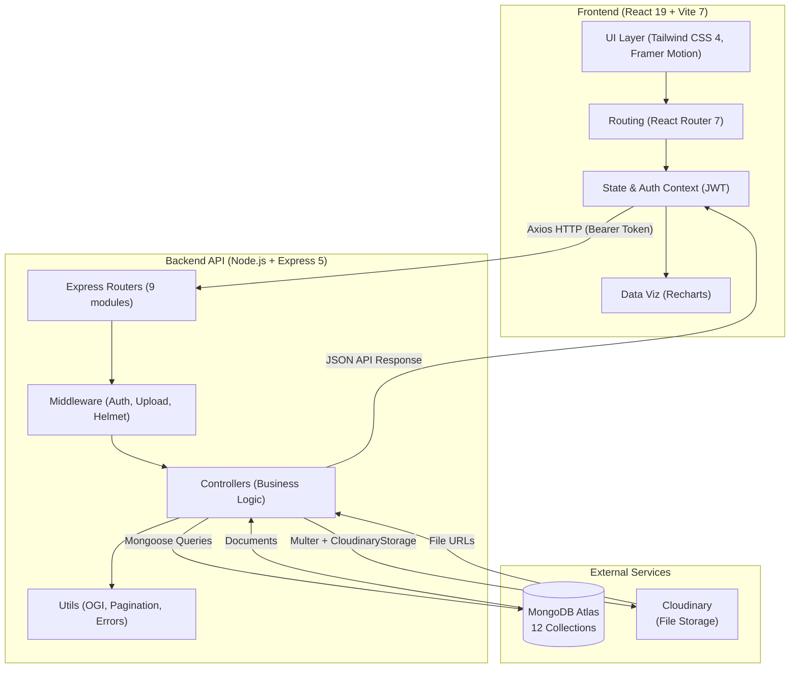
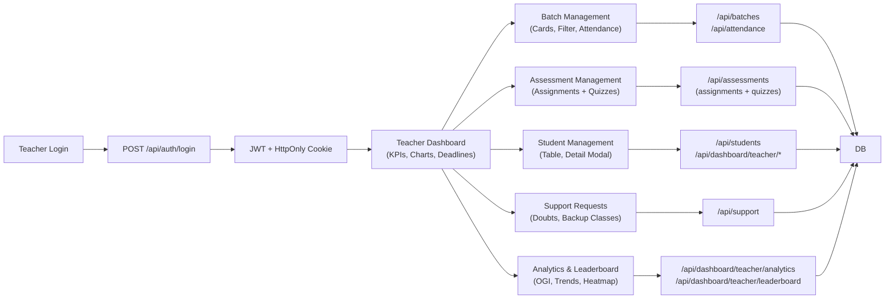
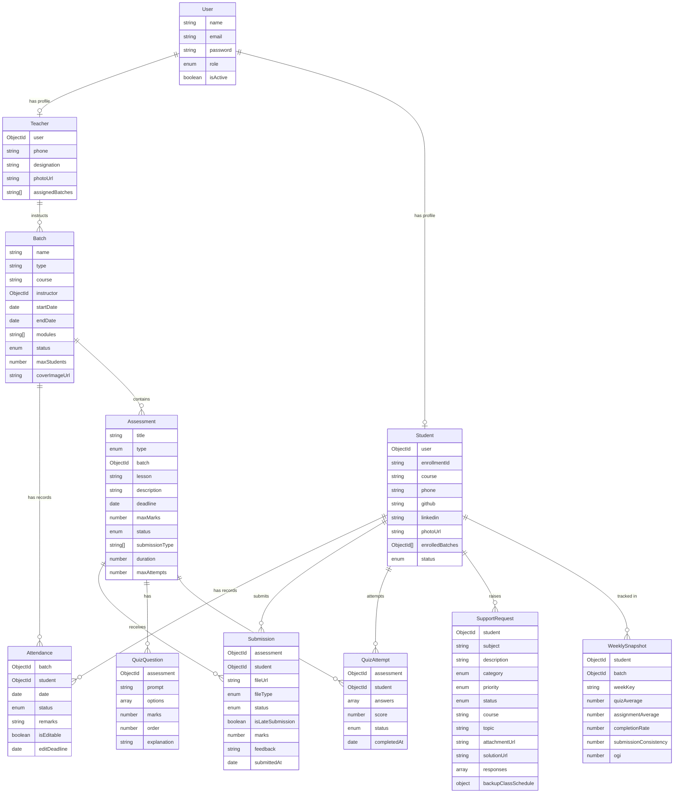

# Mind Rise — System Architecture

This document illustrates the high-level architecture, data flows, and module structure of the **Mind Rise** platform.

---

## 1. High-Level System Diagram



---

## 2. Teacher Module Flow



---

## 3. Database Schema Overview



---

## 4. Frontend Route Structure

```
/                              → Login Page
/admin/dashboard               → Admin Dashboard Home
/admin/batches                 → Admin Batch Management
/admin/batches/:batchId        → Admin Batch Detail
/admin/students                → Admin Student Management
/admin/assessments             → Admin Assessment Management
/admin/support                 → Admin Support Requests
/admin/teachers                → Admin Teacher Management
/teacher-dashboard             → Teacher Dashboard Layout (persistent sidebar)
  /teacher-dashboard           → Teacher Dashboard Home (KPIs, charts)
  /teacher-dashboard/batches   → Batch Management (cards, filter)
  /teacher-dashboard/batches/:batchId → Batch Detail + Attendance
  /teacher-dashboard/assessments → Assignment Management
  /teacher-dashboard/quizzes   → Quiz Management
  /teacher-dashboard/students  → Student Management
  /teacher-dashboard/analytics → Analytics & Leaderboard
  /teacher-dashboard/support   → Support Requests
  /teacher-dashboard/account   → Teacher Account Settings
/public/home                  → Public Home Page
/public/courses               → Courses Listing
/public/courses/:courseId     → Course Details
/public/support-requests      → Public Support Requests View
```

---

## 5. Key Components

### Frontend

| Layer              | Technology                            |
| ------------------ | ------------------------------------- |
| Framework          | React 19 + Vite 7                     |
| Styling            | Tailwind CSS 4, Framer Motion 12      |
| UI Primitives      | Radix UI (Avatar, Tabs, Dialog, etc.) |
| Data Visualization | Recharts 3 (bar, line, area, heatmap) |
| Date Handling      | date-fns 4, react-day-picker 9        |
| HTTP Client        | Axios 1 (with JWT interceptors)       |
| Notifications      | react-hot-toast                       |
| Icons              | Lucide React, react-icons             |

### Backend

| Layer         | Technology                           |
| ------------- | ------------------------------------ |
| Runtime       | Node.js v18+                         |
| Framework     | Express 5                            |
| ODM           | Mongoose 9 (MongoDB)                 |
| Auth          | jsonwebtoken 9, bcryptjs 3           |
| File Upload   | Multer 2 + multer-storage-cloudinary |
| Cloud Storage | Cloudinary SDK 1                     |
| Logging       | Morgan                               |
| Dev           | Nodemon                              |

### Database Collections (MongoDB Atlas)

| Collection      | Model File             | Purpose                          |
| --------------- | ---------------------- | -------------------------------- |
| users           | userModel.js           | Auth credentials + roles         |
| teachers        | teacherModel.js        | Teacher profiles                 |
| students        | studentModel.js        | Student profiles + enrollment    |
| batches         | batchModel.js          | Batch/course management          |
| attendances     | attendanceModel.js     | Session attendance records       |
| assessments     | assessmentModel.js     | Assignments + quizzes            |
| submissions     | submissionModel.js     | File submissions + grades        |
| quizquestions   | quizQuestionModel.js   | MCQ question bank                |
| quizattempts    | quizAttemptModel.js    | Student quiz attempt records     |
| supportrequests | supportRequestModel.js | Doubts + backup class scheduling |
| weeklysnapshots | weeklySnapshotModel.js | Weekly performance aggregations  |
| contacts        | contactModels.js       | Public contact form submissions  |

---

## 6. OGI Calculation Architecture

```
OGI = (Attendance% × 0.4) + (Academic Grade% × 0.6)

Attendance% = (Present Sessions + 0.5 × Late Sessions) / Total Sessions × 100

Academic Grade% = Average of:
  - Assignment scores (normalized to 100)
  - Quiz scores (normalized to 100)

Growth Classification:
  OGI >= 80% → Excellent
  OGI >= 60% → Improving
  OGI >= 40% → Stable
  OGI <  40% → Needs Attention
```

OGI is recalculated in:

- `analyticsController.js` — for leaderboard and class analytics
- `studentController.js` — for individual student progress endpoint
- `weeklySnapshotModel.js` — stored per-week for trend visualization

---

## 7. File Upload Architecture

```
Client (File Input)
    ↓
Multer Middleware (in-memory buffer, 10MB limit)
    ↓
multer-storage-cloudinary (direct stream to Cloudinary)
    ↓
Cloudinary (stores file, returns secure URL)
    ↓
Controller (saves URL to MongoDB document)
    ↓
Client (displays file URL for preview/download)
```

**Upload use cases:**

- Batch cover images → `batches` collection
- Assignment submission files → `submissions` collection
- Support request attachments → `supportrequests` collection
- Support solution files → `supportrequests` collection _(partial — H5)_
- Teacher profile photos → `teachers` collection

---

## 8. Security Architecture

| Concern            | Implementation                                        |
| ------------------ | ----------------------------------------------------- |
| Authentication     | JWT (HS256), 24h expiry                               |
| Token Storage      | HTTP-only cookie (server) + sessionStorage (client)   |
| Authorization      | Role middleware: `Admin`, `Teacher`, `Student`        |
| Password Hashing   | bcryptjs (salt rounds: 10)                            |
| XSS Protection     | HTTP-only cookies, Helmet headers                     |
| CSRF Protection    | SameSite=strict cookie policy                         |
| File Upload Safety | Multer type whitelist, 10MB size limit                |
| Rate Limiting      | express-rate-limit _(pending re-implementation — L3)_ |

---

_Last updated: February 2026 — Mind Rise (NavKalpana RICR-NK-0003)_
