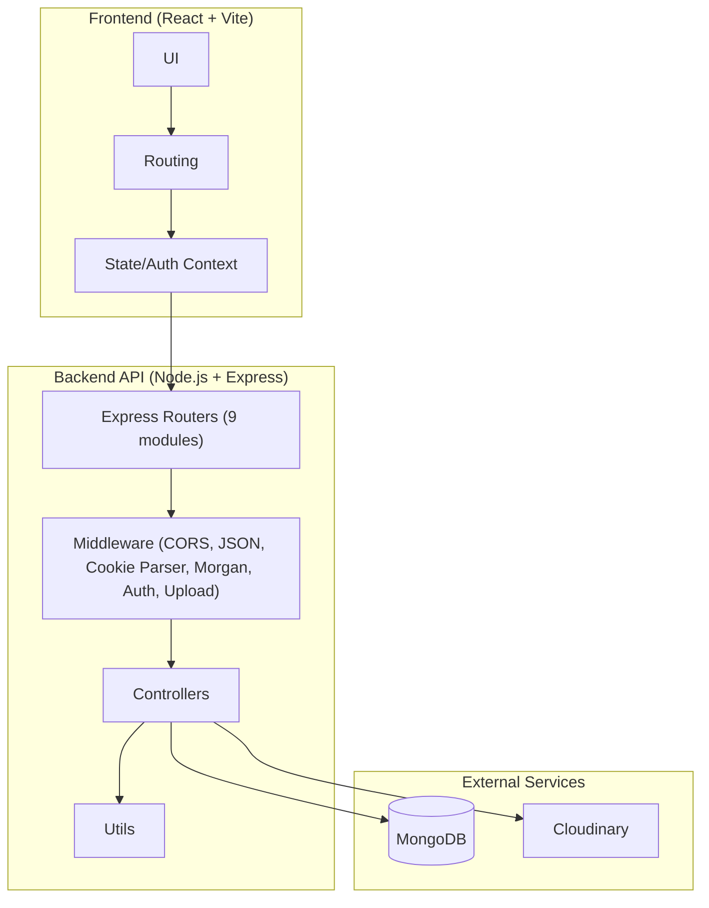

# Mind Rise System Architecture

This document reflects the current backend implementation.

## 1. High-Level System Diagram



## 2. Backend Routers

- `authRouter`
- `contactRoutes`
- `studentRoutes`
- `batchRoutes`
- `attendanceRoutes`
- `assessmentRoutes`
- `supportRoutes`
- `dashboardRoutes`
- `teacherRoutes`

## 3. Database Models

The backend defines the following models:

- `userModel`
- `teacherModel`
- `studentModel`
- `batchModel`
- `attendanceModel`
- `assessmentModel`
- `submissionModel`
- `quizQuestionModel`
- `quizAttemptModel`
- `supportRequestModel`
- `weeklySnapshotModel`
- `contactModels`

## 4. File Upload Flow

```
Client -> Multer middleware -> Cloudinary -> Controller -> MongoDB
```

Uploads are used for:

- Batch cover images
- Assessment files (pdf/image)
- Support request files
- Teacher profile photos

## 5. Auth Flow

```
Client -> /api/auth/login -> JWT -> HTTP-only cookie + response token
Protected routes verify JWT via auth middleware
```

Last updated: February 26, 2026
